# Chrome Extensions & Local-First Developer Suite

<p align="center">
  <em>High-performance, privacy-first, zero-cloud browser extensions and client-side developer utilities engineered for local execution, responsive layout debugging, PII redaction, and offline financial auditing.</em>
</p>

<p align="center">
  
  
  
  
  
</p>

<p align="center">
  <a href="https://github.com/RayAashish/chrome-extensions/releases/tag/v2026.11.14">
    
  </a>
  <a href="https://github.com/RayAashish/chrome-extensions/releases/download/v2026.11.14/codestripper-v2.0.0.zip">
    
  </a>
  <a href="https://github.com/RayAashish/chrome-extensions/releases/download/v2026.11.14/smart-pii-sanitizer-v1.0.0.zip">
    
  </a>
  <a href="https://github.com/RayAashish/chrome-extensions/releases/download/v2026.11.14/localhost-multiview-webhook-inspector-v1.0.0.zip">
    
  </a>
  <a href="https://github.com/RayAashish/chrome-extensions/releases/download/v2026.11.14/statement2ledger-v1.0.0.zip">
    
  </a>
</p>

---

## Overview & Key Highlights

### Problem Statement
Modern frontend engineers, security researchers, and finance analysts constantly struggle with compromised local privacy and fragmented toolchains. Debugging responsive breakpoints typically requires juggling five browser tabs or purchasing cumbersome tunneling subscriptions; sharing code snippets with AI models inadvertently leaks production secrets, bearer tokens, and customer PII; reading technical tutorials requires manual copy-pasting of scattered code blocks; and parsing sensitive Indian bank statements forces users to upload confidential financial data to proprietary third-party servers.

### Core Value Proposition
- **100% Local-First & Air-Gapped:** Zero external API calls, zero telemetry tracking, zero remote CDN scripts, and zero cloud proxy tunnels. All computation runs purely inside the local browser engine and device memory.
- **Sub-Millisecond Deterministic Latency:** High-throughput processing powered by native Web Crypto (`crypto.subtle`), multi-threaded Web Workers, and optimized single-pass algorithms capable of tokenizing 100,000+ lines of code under 1.5 seconds.
- **Manifest V3 Production Compliance:** Strict adherence to Chrome Extension Manifest V3 security boundaries, declarative net request session rules, closed shadow DOM isolation, and ephemeral session memory vaults.

### Feature Matrix

- **Localhost Multi-View & Webhook Inspector:**
  - 3-way responsive layout mirror (iPhone 15 Mobile, iPad 10th Gen Tablet, 1080p Desktop) with synchronized scrolling, clicking, navigation, and typing.
  - Native prototype property setter injection (`HTMLInputElement.prototype.value`) guaranteeing state synchronization in React, Vue, and Angular controlled inputs.
  - Safe DeclarativeNetRequest session rules stripping `X-Frame-Options` and CSP `frame-ancestors` strictly for loopback sub-frames (`localhost`, `127.0.0.1`, `[::1]`).
  - Follower breakpoint element mismatch detection (`⚠️ Element not found/hidden in this viewport`).
  - Web Crypto HMAC signature generator (Stripe, GitHub, Shopify, generic) and dynamic variable evaluation (`{{timestamp}}`, `{{uuid}}`, `{{random_email}}`).

- **Smart PII Sanitizer:**
  - Deterministic regex & Shannon-entropy entity scanner detecting API keys, JWTs, AWS credentials, credit cards (Luhn validated), emails, phones, SSNs, Aadhaar, and PAN cards.
  - Structure-preserving redaction with variable-length mapping and automatic reverse restoration.
  - Client-side Web Crypto AES-GCM 256-bit encrypted session storage vault with auto-expiring keys.
  - Capture-phase paste interception modal rendered inside an isolated, tamper-proof Closed Shadow DOM.

- **CodeStripper: Technical Tutorial Distiller:**
  - Vite + Tailwind v4 + CRXJS Chrome side panel extension extracting compile-ready code snippets from narrative blog posts.
  - Heuristic language inference, shebang detection, and automated file-path synthesis.
  - In-browser project skeleton compiler generating downloadable `.zip` bundles using JSZip.

- **Statement2Ledger: Offline Financial Parser:**
  - Client-side Web Worker PDF & CSV parser tailored for Indian financial institutions (HDFC, SBI, ICICI).
  - Positional coordinate token clustering via bundled PDF.js worker, eliminating server OCR dependencies.
  - Integer-paise running-balance mathematical validation to prevent floating-point rounding errors.
  - Audit-ready multi-sheet XLSX and ledger CSV exports generated via client-side RAM Blobs.

---

## System Architecture & Workflow

### High-Level Architecture Diagram

```mermaid
graph TD
    subgraph BrowserHost["Client Host & Browser Environment"]
        subgraph MultiViewApp["Localhost Multi-View & Webhook Inspector"]
            WorkspaceHub["Workspace Parent Controller"] <--> MessageRelay["Hub-and-Spoke Relay"]
            MessageRelay <--> FrameMobile["Mobile Viewport (393x852)"]
            MessageRelay <--> FrameTablet["Tablet Viewport (820x1180)"]
            MessageRelay <--> FrameDesktop["Desktop Viewport (1920x1080)"]
            WebhookUI["Request Composer"] --> SubtleHMAC["Web Crypto API (HMAC-SHA256)"]
            SubtleHMAC --> Dispatcher["Loopback Fetch Dispatcher"]
        end

        subgraph SanitizerApp["Smart PII Sanitizer (MV3)"]
            CaptureListener["Capture-Phase Paste Interceptor"] --> ShadowRoot["Closed Shadow DOM Modal"]
            ShadowRoot --> Scanner["Single-Pass Regex & Entropy Engine"]
            Scanner <--> EphemeralVault["chrome.storage.session AES-GCM Vault"]
            EphemeralVault <--> ReverseRestorer["Longest-Match Reverse Mapper"]
        end

        subgraph CodeStripperApp["CodeStripper (MV3 SidePanel)"]
            DOMTraversal["DOM Article Extractor"] --> Classifier["Syntax & File Path Classifier"]
            Classifier --> ZipEngine["JSZip Memory Compiler"]
        end

        subgraph LedgerApp["Statement2Ledger (PWA / Offline)"]
            FileInput["PDF / CSV File Dropzone"] --> DedicatedWorker["Background Web Worker"]
            DedicatedWorker --> PDFClustering["PDF.js Positional Clusterer"]
            PDFClustering --> BankAdapters["Bank Parsers (HDFC / SBI / ICICI)"]
            BankAdapters --> MathValidator["Integer Paise Balance Reconciler"]
            MathValidator --> ExcelBuilder["SheetJS XLSX Generator"]
        end
    end

    Dispatcher --> LocalServer["Local Application Under Test (http://localhost:3000 / 8080)"]
```



### Component Breakdown

⚬ **Presentation Layer:**
- Responsive workspace canvases and Chrome side panels (`chrome.sidePanel`) styled with scoped CSS and Tailwind CSS v4.
- Closed Shadow DOM (`mode: 'closed'`) modal mounts preventing style bleed or JavaScript tampering from host web pages.
- Hardware-accelerated CSS 2D transformations (`transform: scale()`) enabling accurate media-query evaluation inside scaled iframe viewports.

⚬ **Core Engine / Processing:**
- Web Worker background threads offloading CPU-intensive PDF parsing, font table tokenization, and regex evaluations without freezing the browser UI.
- Deterministic prototype property overriding (`HTMLInputElement.prototype.value`) paired with synthetic event bubbling (`input`, `change`) to trigger internal React/Vue reactivity fibers.
- Integer-paise financial reconciliation math ensuring complete accounting accuracy across multi-thousand row bank statements.

⚬ **Data & I/O:**
- Ephemeral in-memory storage using `chrome.storage.session`, guaranteeing mapping vaults and encryption keys vanish upon tab/browser closure.
- DeclarativeNetRequest session rules dynamically stripping restrictive `X-Frame-Options` and `frame-ancestors` headers strictly on local `sub_frame` requests.
- Zero-telemetry file serialization directly into RAM-backed `Blob` objects and downloaded via native `URL.createObjectURL()`.

---

## Project Structure

```text
chrome-extensions/
├── .env.example                               # Global environment configuration template
├── .gitignore                                 # Comprehensive multi-layer exclusions
├── README.md                                  # Architectural specification & guide
├── code-stripper/                             # Technical Tutorial Distiller Extension
│   ├── manifest.json                          # MV3 manifest definition
│   ├── package.json                           # TypeScript, Tailwind & Vite configuration
│   ├── src/
│   │   ├── background/index.ts                # Service worker & sidepanel controller
│   │   ├── content/extractor.ts               # DOM traversal & clean code extraction
│   │   ├── core/classifier.ts                 # Heuristic language & file path inference
│   │   ├── core/zipBuilder.ts                 # In-memory JSZip project builder
│   │   └── sidepanel/                         # Reactive UI sidepanel view
│   └── test/                                  # Vitest unit test suites
├── localhost-multiview-webhook-inspector/     # Responsive Multi-View & Webhook Tester
│   ├── manifest.json                          # MV3 manifest with DeclarativeNetRequest
│   ├── background/service-worker.js           # Session rules & workspace management
│   ├── companion/receiver.js                  # Zero-dependency local webhook listener
│   ├── content/frame-agent.js                 # In-frame state & interaction mirror
│   ├── devtools/                              # Chrome DevTools network panel tab
│   ├── shared/                                # Locator, protocol & device matrices
│   ├── webhooks/                              # HMAC simulation & payload templates
│   ├── workspace/                             # Multi-device canvas dashboard
│   ├── demo/                                  # Acceptance scenario testbed & mock server
│   └── test/                                  # Node.js native test runner suites
├── smart-pii-sanitizer/                       # Deterministic PII Redaction & Reverse Mapping
│   ├── manifest.json                          # MV3 extension manifest
│   ├── app.html                               # Standalone offline web utility
│   ├── background/service-worker.js           # Background lifecycle worker
│   ├── content/paste-guard.js                 # Capture-phase paste protector
│   ├── core/                                  # Vault, Sanitizer, Detectors & Web Crypto
│   ├── options/ & popup/ & sidepanel/         # Interactive UI consoles
│   └── test/                                  # Acceptance, edge case & benchmark tests
└── statement2ledger/                          # Bank Statement to Excel Converter
    ├── index.html                             # Local web application entrypoint
    ├── vite.config.ts                         # Client bundle configuration
    ├── src/
    │   ├── core/                              # Narration parsing, categorization & math
    │   ├── export/                            # Multi-sheet XLSX & CSV generators
    │   ├── parsers/                           # Bank-specific extraction adapters
    │   ├── ui/                                # Component views & password prompt modals
    │   └── workers/parse.worker.ts            # Non-blocking PDF parsing thread
    └── tests/                                 # Unit, integration & fuzzing test suites
```

---

## Getting Started & Local Setup

### Prerequisites
- **Node.js:** v18.0.0 or higher (v20+ recommended)
- **Package Manager:** `npm` v9+ or `pnpm`
- **Browser:** Google Chrome (v116+ for SidePanel APIs), Microsoft Edge, Brave, or Chromium alternatives.

### Installation & Run

1. **Clone the repository:**
   ```bash
   git clone https://github.com/RayAashish/chrome-extensions.git
   cd chrome-extensions
   ```

2. **Configure environment template (if customizing ports):**
   ```bash
   cp .env.example .env
   ```

3. **Build the extension distributions:**
   ```bash
   # Build CodeStripper
   cd code-stripper
   npm install && npm run build
   cd ..

   # Build Statement2Ledger
   cd statement2ledger
   npm install && npm run build
   cd ..
   ```

4. **Execute Automated Test Suites (208+ Tests):**
   ```bash
   # Run all automated unit and integration tests across the monorepo
   npm test --prefix code-stripper
   npm test --prefix statement2ledger
   npm test --prefix localhost-multiview-webhook-inspector
   npm test --prefix smart-pii-sanitizer
   ```

5. **Load Extensions into Chrome / Chromium:**
   - Navigate to `chrome://extensions/` in your browser.
   - Toggle **Developer mode** in the top-right corner.
   - Click **Load unpacked** in the top-left toolbar.
   - Select any of the target extension directories:
     - `code-stripper/dist`
     - `smart-pii-sanitizer`
     - `localhost-multiview-webhook-inspector`

---

## Privacy, Permissions & Security

- **Strict Local Execution:** All processes execute 100% within the client browser sandbox. No analytics trackers, external beacons, or third-party telemetric scripts are bundled.
- **Volatile Vault Lifecycle:** Session tokens, encryption secrets, and bank statement buffers are held exclusively in ephemeral memory contexts (`chrome.storage.session`) and cleared upon browser termination.
- **Declarative Net Request Scoping:** DNR header modifications are strictly limited to `sub_frame` requests initiated towards local development loopbacks (`localhost`, `127.0.0.1`, `[::1]`, `*.localhost`). Top-level browsing and external websites are never altered.
- **Air-Gapped Compliance:** All stylesheets, icons, fonts, and worker scripts (`pdf.worker.min.mjs`) are bundled locally to guarantee air-gapped, offline compliance without external CDN dependencies.

---

## License & Attribution

This project is licensed under the **MIT License**. You are free to inspect, modify, and distribute the code in accordance with the license conditions.
