# Chrome Extensions & Privacy-First Web Tools Suite

<p align="center">
  <em>A production-ready monorepo of zero-cloud browser extensions and client-side web tools engineered for deterministic financial parsing, confidential LLM data sanitization, code extraction, and synchronized multi-viewport developer diagnostics.</em>
</p>

<p align="center">
  
  
  
  
  
</p>

<p align="center">
  <a href="https://github.com/RayAashish/chrome-extensions/releases/tag/v2026.11.14">
    
  </a>
  <a href="https://github.com/RayAashish/chrome-extensions">
    
  </a>
</p>

---

## Overview & Key Highlights
- **Problem Statement:** Modern developer and financial workflows frequently leak private encryption keys, bearer tokens, customer PII (PAN, Aadhaar, SSN), and confidential bank statements to remote cloud servers and SaaS proxies. Developers also lose time manually distilling messy online tutorials and debugging non-synchronized responsive layouts across viewports.
- **Core Value Proposition:** 100% on-device, client-side processing with zero cloud telemetry. All cryptographic operations (Web Crypto AES-GCM, HMAC-SHA256, PBKDF2), PDF parsing, regex redaction, and multi-viewport relays execute entirely within browser memory. No data ever leaves your computer.
- **Feature Matrix:**
  - **CodeStripper:** Extracts, categorizes, and compiles clean code snippets and configs from messy web tutorials into downloadable `.zip` project skeletons.
  - **Smart PII Sanitizer:** Deterministically replaces sensitive credentials and PII with format-valid synthetic tokens before pasting into LLMs, featuring one-click reverse mapping.
  - **Localhost Multi-View & Webhook Inspector:** Renders synchronized mobile, tablet, and desktop viewports side-by-side with scroll/click parity and generates signed local webhook dispatches (Stripe, GitHub, Shopify) without cloud tunnels.
  - **Statement2Ledger:** Converts Indian bank statement PDFs and CSVs into standardized, audit-ready Excel ledgers completely offline with integer paise balance reconciliation.

---

## System Architecture & Workflow

### High-Level Architecture Diagram

```mermaid
graph TD
    subgraph ClientEnvironment["100% Local Client Environment (Zero Cloud I/O)"]
        subgraph CodeStripper["CodeStripper (Manifest V3)"]
            CS_DOM["DOM Content Extractor"] --> CS_Class["Language & Path Classifier"]
            CS_Class --> CS_Zip["JSZip Skeleton Generator"]
        end

        subgraph PIISanitizer["Smart PII Sanitizer (Manifest V3)"]
            PII_Paste["Paste Event Capture Phase"] --> PII_Shadow["Shadow DOM Protection Prompt"]
            PII_Shadow --> PII_Engine["Interval Overlap Sanitizer"]
            PII_Engine <--> PII_Vault["Session Vault & AES-GCM Encryptor"]
            PII_Vault <--> PII_Reverse["Longest-Match Reverse Mapper"]
        end

        subgraph WebhookInspector["Localhost Multi-View & Webhook Inspector"]
            WH_Hub["Workspace Controller"] <--> WH_Relay["Channel Token Bus"]
            WH_Relay <--> WH_Views["Synchronized Iframes (Mobile/Tablet/Desktop)"]
            WH_Comp["Request Composer"] --> WH_Crypto["Web Crypto HMAC-SHA256"]
            WH_Crypto --> WH_Local["Localhost HTTP Dispatcher"]
        end

        subgraph Statement2LedgerApp["Statement2Ledger (Offline Web App)"]
            S2L_File["Bank PDF/CSV Dropzone"] --> S2L_Worker["Dedicated Web Worker Thread"]
            S2L_Worker --> S2L_PDF["PDF.js Positional Layout Engine"]
            S2L_PDF --> S2L_Bank["Bank Parser Adapters (HDFC/SBI/ICICI)"]
            S2L_Bank --> S2L_Math["Integer Paise Math Validator"]
            S2L_Math --> S2L_Export["Audit-Ready Multi-Sheet XLSX"]
        end
    end

    WH_Local --> LocalServer["Local App Server (localhost:8080)"]
```


### Component Breakdown

⚬ Presentation Layer:
- **Tailwind CSS & Sidepanel Panes:** Extension views leverage `chrome.sidePanel`, options consoles, and standalone offline pages styled with clean, responsive Tailwind CSS layouts.
- **Closed Shadow DOM Roots:** User-facing injection overlays (e.g. Paste Guard) mount inside closed Shadow DOM roots to prevent style bleed or DOM tampering by host web applications.
- **Hardware-Accelerated Scaling:** Iframe viewports render with true CSS pixel densities and fit into desktop viewports via CSS `transform: scale()`.

⚬ Core Engine / Processing:
- **Web Worker Threading:** Statement2Ledger delegates PDF rasterization and spatial clustering to background Web Workers, guaranteeing 60fps UI responsiveness.
- **Deterministic Tokenization:** Smart PII Sanitizer uses priority interval conflict resolution (`resolveOverlaps`) to avoid nested entity collisions and Luhn checksum validation for card identification.
- **Integer Paise Arithmetic:** Balance calculations avoid IEEE 754 floating-point errors by reconciling running totals using exact integer paise arithmetic.

⚬ Data & I/O:
- **Volatile Storage Lifecycles:** Temporary mapping tokens and decryption keys reside in `chrome.storage.session` and are purged automatically when the browser session ends.
- **Declarative Net Request Engine:** The multi-view workspace dynamically manages session rules via `chrome.declarativeNetRequest` strictly for loopback origins (`localhost`, `127.0.0.1`), removing restrictive frame-ancestor headers for local preview without opening security holes for external sites.
- **Client-Side Blob Exports:** All file outputs (ZIP, XLSX, CSV, JSON) are assembled purely in browser RAM via Blob URLs without intermediate disk or server hops.

---

## Project Structure

```text
chrome-extensions/
├── .env.example                               # Environment variable template
├── .gitignore                                 # Multi-tier exclusion rules
├── README.md                                  # Monorepo architectural documentation
├── code-stripper/                             # Tutorial to Project Skeleton Distiller
│   ├── manifest.json                          # Chrome Extension Manifest V3
│   ├── package.json                           # Dependencies and build scripts
│   ├── src/
│   │   ├── background/index.ts                # Service worker & side panel triggers
│   │   ├── content/extractor.ts               # DOM traversal & snippet extraction
│   │   ├── core/classifier.ts                 # Heuristic syntax & language detection
│   │   ├── core/zipBuilder.ts                 # In-memory JSZip project builder
│   │   └── sidepanel/                         # Reactive side panel user interface
│   └── test/                                  # Vitest unit test suite
├── localhost-multiview-webhook-inspector/     # Multi-Viewport & Webhook Debugger
│   ├── manifest.json                          # MV3 manifest with Declarative Net Request
│   ├── background/service-worker.js           # Session rules & frame lifecycle
│   ├── companion/receiver.js                  # Standalone local webhook listener
│   ├── content/frame-agent.js                 # Event normalization & sync agent
│   ├── devtools/                              # Dedicated DevTools inspection tab
│   ├── shared/                                # Locators, sync protocol, and device presets
│   ├── webhooks/                              # HMAC simulation & payload templates
│   └── workspace/                             # Multi-device responsive grid canvas
├── smart-pii-sanitizer/                       # PII Redaction & Reverse-Mapping Tool
│   ├── manifest.json                          # Chrome Extension Manifest V3
│   ├── app.html                               # Standalone offline web application
│   ├── background/service-worker.js           # Ephemeral MV3 service worker
│   ├── content/paste-guard.js                 # Capture-phase paste interception
│   ├── core/                                  # Vault, Sanitizer, Detectors & Web Crypto
│   ├── options/ & popup/ & sidepanel/         # Settings, toolbar & sidepanel consoles
│   └── test/                                  # Acceptance, vault, and regex test suites
└── statement2ledger/                          # Bank Statement to Excel Converter
    ├── index.html                             # Local web application entrypoint
    ├── vite.config.ts                         # Vite client configuration
    ├── src/
    │   ├── core/                              # Narration parsing, categorization & math
    │   ├── export/                            # Multi-sheet XLSX & CSV generators
    │   ├── parsers/                           # HDFC, SBI, ICICI & generic bank adapters
    │   ├── ui/                                # Component views & password prompt modals
    │   └── workers/parse.worker.ts            # Non-blocking PDF parsing worker thread
    └── tests/                                 # Unit, integration & fuzzing test suites
```

---

## Getting Started & Local Setup

### Prerequisites

⚬ **Node.js:** v18.0.0 or higher (v20+ recommended)  
⚬ **Package Manager:** `npm` v9+ or `pnpm`  
⚬ **Browser:** Google Chrome v116+ (or any Chromium browser supporting Manifest V3 Sidepanel & Offscreen APIs)  
⚬ **Optional Tools:** GitHub CLI (`gh`) for automated release artifact deployment  

### Installation & Run

1. **Clone repository:**
   ```bash
   git clone https://github.com/RayAashish/chrome-extensions.git
   cd chrome-extensions
   ```

2. **Environment configuration:**
   ```bash
   cp .env.example .env
   ```

3. **Install dependencies & build applications:**
   ```bash
   # Build CodeStripper extension
   cd code-stripper && npm install && npm run build && cd ..

   # Build Statement2Ledger web app
   cd statement2ledger && npm install && npm run build && cd ..

   # Statement2Ledger Local Development Server
   cd statement2ledger && npm run dev
   # Open http://localhost:5173 (Works fully with Wi-Fi turned OFF)
   ```

4. **Run monorepo test suites:**
   ```bash
   npm test --prefix code-stripper
   npm test --prefix statement2ledger
   npm test --prefix localhost-multiview-webhook-inspector
   npm test --prefix smart-pii-sanitizer
   ```

5. **Load extensions into Chrome or Edge:**
   1. Open `chrome://extensions/` or `edge://extensions/`.
   2. Turn on **Developer mode** in the upper-right corner.
   3. Click **Load unpacked**.
   4. Select the target project folder:
      - `code-stripper/dist`
      - `smart-pii-sanitizer`
      - `localhost-multiview-webhook-inspector`

---

## Privacy, Permissions & Security

⚬ **Strict Scoped Storage & In-Memory Execution:** All application states, statement buffers, and redacted PII mappings are held exclusively in volatile memory (`chrome.storage.session` or Web Worker memory scopes) and are destroyed upon tab/session close.  
⚬ **Zero Network Activity & No Cloud Logging:** Web applications enforce strict Content-Security-Policies (`connect-src 'none'`). All parsing, OCR extraction, and regex classification run locally.  
⚬ **Scoped DNR Rules:** `declarativeNetRequest` header adjustments are strictly constrained to loopback origins (`localhost`, `127.0.0.1`, `*.localhost`) for subframe contexts only. Public network requests are never modified.  
⚬ **Zero Third-Party Telemetry:** No analytics beacons, trackers, or remote fonts/scripts are present in the repository.

---

## License & Attribution

⚬ **License:** Distributed under the [MIT License](https://opensource.org/licenses/MIT).  
⚬ **Attribution:** Built with open web standards (Web Crypto API, Web Workers, CSS Transforms, PDF.js, SheetJS, and Tailwind CSS).
