# Chrome Extensions & Local-First Web Tools

<p align="center">
  <em>A high-performance monorepo of zero-cloud browser extensions and client-side developer utilities engineered for privacy, security, and offline execution.</em>
</p>

<p align="center">
  
  
  
  
  
</p>

<p align="center">
  <a href="https://github.com/RayAashish/chrome-extensions/releases/tag/v2026.11.14">
    
  </a>
  <a href="https://github.com/RayAashish/chrome-extensions/releases">
    
  </a>
</p>

---

## Overview & Key Highlights

Modern developer workflows demand responsive testing, sensitive data protection, code extraction, and financial parsing. However, traditional browser utilities often route confidential code, personal credentials, and private financial statements through untrusted cloud servers.

This monorepo delivers four modular, production-ready developer tools built strictly on **local-first, zero-telemetry architecture**:

- **Problem Statement:** Developers frequently expose sensitive API keys, customer PII, and financial data to external third parties when pasting code snippets into LLMs, converting bank statements, or debugging webhooks through remote proxy tunnels.
- **Core Value Proposition:** 100% client-side computation. All tokenization, parsing, cryptography (Web Crypto AES-GCM/PBKDF2), and viewport synchronizations occur strictly within the browser memory and local host. Zero cloud logging, zero external analytics, and zero remote dependencies.

### Feature Matrix

| Suite Application | Core Engine | Primary Capability | Key Advantage |
| :--- | :--- | :--- | :--- |
| **CodeStripper** | TypeScript + Vite + JSZip | Distills code snippets & project skeletons from technical tutorials | One-click ZIP generation with deterministic language detection |
| **Smart PII Sanitizer** | Web Crypto + Shadow DOM + Session Vault | Sanitizes PII & secrets before pasting into AI chats with reverse-mapping | Deterministic tokens, Luhn check, zero server communication |
| **Localhost Multi-View & Webhook Inspector** | Declarative Net Request + SubtleCrypto | Multi-viewport responsive UI sync & local HMAC webhook simulation | Zero tunnel requirement, Stripe/GitHub HMAC validation, frame sync |
| **Statement2Ledger** | Web Workers + PDF.js + SheetJS | Converts Indian bank statement PDFs/CSVs to audit-ready Excel ledgers | Pure client-side parsing, running-balance math reconciliation |

---

## System Architecture & Workflow

### High-Level Architecture Diagram

```mermaid
flowchart TD
    subgraph BrowserContext["Browser & Host Environment"]
        subgraph CodeStripperApp["CodeStripper (MV3)"]
            DOMScraper["DOM Extractor & Cleaner"] --> ASTClassifier["Language & Path Classifier"]
            ASTClassifier --> ZipGenerator["JSZip Project Builder"]
        end

        subgraph PIISanitizerApp["Smart PII Sanitizer (MV3)"]
            PasteListener["Capture-Phase Paste Interceptor"] --> ShadowPrompt["Shadow DOM Guard Modal"]
            ShadowPrompt --> SanitizerEngine["Single-Pass Regex & Entity Tokenizer"]
            SanitizerEngine <--> MemoryVault["Session Storage Vault & AES-GCM Encryptor"]
            MemoryVault <--> ReverseMapper["Longest-Match Reverse Restorer"]
        end

        subgraph WebhookInspectorApp["Multi-View & Webhook Inspector"]
            ParentWorkspace["Workspace Controller (Hub)"] <--> SyncRelay["Channel Token & Event Relay"]
            SyncRelay <--> ViewportFrames["Synchronized IFrames (Mobile / Tablet / Desktop)"]
            WebhookComposer["Local Request Composer"] --> SubtleCrypto["Web Crypto API (HMAC-SHA256)"]
            SubtleCrypto --> LocalEndpoint["Localhost HTTP Dispatcher"]
        end

        subgraph StatementLedgerApp["Statement2Ledger (Offline PWA)"]
            DropZone["PDF / CSV Ingestion"] --> WorkerThread["Dedicated Web Worker"]
            WorkerThread --> PositionalPDF["PDF.js Positional Tokenizer"]
            PositionalPDF --> RuleParsers["Bank Format Adapters (HDFC / SBI / ICICI)"]
            RuleParsers --> MathReconciliation["Integer Paise Balance Validator"]
            MathReconciliation --> SheetExporter["Audit-Ready Multi-Sheet XLSX"]
        end
    end

    LocalEndpoint --> LocalDevServer["Local Application Server (localhost:8080)"]
```



### Component Breakdown

#### ⚬ Presentation Layer
- **Reactive UI Interfaces:** Built with tailored Tailwind CSS and modern CSS Grid/Flexbox layouts inside dedicated Chrome side panels (`chrome.sidePanel`), options tabs, and standalone offline pages.
- **Isolated Injection Elements:** In-page warning banners and interaction pills (e.g., Smart PII Sanitizer) mount inside isolated **Closed Shadow DOM** roots to prevent CSS pollution or script tampering by host web applications.
- **Dynamic Viewport Scaling:** Hardware-accelerated CSS transforms (`transform: scale()`) support responsive previews across multi-device configurations without altering iframe pixel densities.

#### ⚬ Core Engine & Processing
- **Deterministic Heuristic Classifiers:** Rule-based language syntax classification, line-number filtering, and automated file-extension inferencing.
- **Web Worker Offloading:** CPU-intensive text tokenization and PDF canvas parsing run on isolated background threads via Web Workers, keeping user interfaces completely non-blocking.
- **Integer Arithmetic Verification:** Strict mathematical reconciliation algorithms compute financial balances using whole integer paise to prevent IEEE 754 floating-point drift.

#### ⚬ Data & I/O
- **Volatile In-Memory Vaults:** State management relies on `chrome.storage.session`, guaranteeing sensitive mapping tokens are wiped automatically when browser sessions conclude.
- **Declarative Net Request Engine:** Dynamically injects and cleans HTTP headers strictly for loopback hosts (`127.0.0.1`, `localhost`), stripping restrictive frame-ancestor constraints during local responsive testing.
- **Export Serialization:** File downloads (ZIP, XLSX, CSV, JSON) are assembled in client RAM via Blob constructors and triggered through native browser Object URLs.

---

## Project Structure

```text
chrome-extensions/
├── .env.example                               # Global configuration template
├── .gitignore                                 # Comprehensive multi-layer exclusions
├── README.md                                  # Monorepo architecture & specifications
├── code-stripper/                             # Tutorial to Project Skeleton Distiller
│   ├── manifest.json                          # MV3 manifest definition
│   ├── package.json                           # TypeScript & Vite tooling
│   ├── src/
│   │   ├── background/index.ts                # Service worker & side panel controller
│   │   ├── content/extractor.ts               # DOM traversal & code cleaner
│   │   ├── core/classifier.ts                 # Heuristic syntax & path inference
│   │   ├── core/zipBuilder.ts                 # JSZip archive compiler
│   │   └── sidepanel/                         # Reactive UI sidepanel view
│   └── test/                                  # Vitest unit test suites
├── localhost-multiview-webhook-inspector/     # Responsive Multi-Viewport & Webhook Tester
│   ├── manifest.json                          # MV3 manifest with Declarative Net Request
│   ├── background/service-worker.js           # Session rules & workspace management
│   ├── companion/receiver.js                  # Standalone local hook listener
│   ├── content/frame-agent.js                 # Viewport state & interaction mirror
│   ├── devtools/                              # Chrome DevTools network inspector tab
│   ├── shared/                                # Locator, protocol & device matrices
│   ├── webhooks/                              # HMAC simulation & payload templates
│   └── workspace/                             # Multi-device canvas dashboard
├── smart-pii-sanitizer/                       # Deterministic PII Redaction & Reverse Mapping
│   ├── manifest.json                          # MV3 extension manifest
│   ├── app.html                               # Standalone offline web utility
│   ├── background/service-worker.js           # MV3 background worker
│   ├── content/paste-guard.js                 # Capture-phase paste protector
│   ├── core/                                  # Vault, Sanitizer, Detectors & Web Crypto
│   ├── options/ & popup/ & sidepanel/         # Settings and interactive consoles
│   └── test/                                  # Acceptance & regex performance tests
└── statement2ledger/                          # Bank Statement to Excel Converter
    ├── index.html                             # Local web application entrypoint
    ├── vite.config.ts                         # Client bundle configuration
    ├── src/
    │   ├── core/                              # Narration parsing, categorization & math
    │   ├── export/                            # Multi-sheet XLSX & CSV generators
    │   ├── parsers/                           # Bank-specific extraction adapters
    │   ├── ui/                                # Component views & password prompt modals
    │   └── workers/parse.worker.ts            # Non-blocking PDF parsing thread
    └── tests/                                 # Unit, integration & fuzzing test suites
```

---

## Getting Started & Local Setup

### Prerequisites
- **Node.js:** v18.0.0 or higher (v20+ recommended)
- **Package Manager:** `npm` v9+
- **Browser:** Google Chrome (v116+ for SidePanel APIs), Microsoft Edge, or Chromium-based alternatives.

### Installation & Run

1. **Clone the repository:**
   ```bash
   git clone https://github.com/RayAashish/chrome-extensions.git
   cd chrome-extensions
   ```

2. **Configure environment template (if customizing ports):**
   ```bash
   cp .env.example .env
   ```

3. **Build the projects:**
   ```bash
   # Build CodeStripper extension
   cd code-stripper
   npm install
   npm run build
   cd ..

   # Build Statement2Ledger web application
   cd statement2ledger
   npm install
   npm run build
   cd ..
   ```

4. **Run Unit Tests:**
   ```bash
   npm test --prefix code-stripper
   npm test --prefix statement2ledger
   npm test --prefix localhost-multiview-webhook-inspector
   npm test --prefix smart-pii-sanitizer
   ```

5. **Load Extensions into Chrome / Edge:**
   - Navigate to `chrome://extensions/` (or `edge://extensions/`).
   - Enable **Developer mode** toggle in the top-right corner.
   - Click **Load unpacked**.
   - Select any of the extension build directories:
     - `code-stripper/dist`
     - `smart-pii-sanitizer`
     - `localhost-multiview-webhook-inspector`

---

## Privacy, Permissions & Security

- **Strict Local Execution:** All processes execute 100% within the browser process. No analytics, tracking pixels, or remote scripts are bundled.
- **Volatile Vault Lifecycle:** Session tokens, encryption secrets, and bank statement buffers are held in memory-only storage contexts (`chrome.storage.session`) or ephemeral worker scopes. Wiped immediately upon tab or browser termination.
- **Declarative Net Request Scoping:** DNR header adjustments are strictly scoped to sub-frame contexts targeting loopback hosts (`localhost`, `127.0.0.1`, `*.localhost`). Top-level network navigation and external domains remain entirely unaffected.
- **No Third-Party Cloud CDN Dependencies:** All stylesheets, icons, fonts, and worker scripts (`pdf.worker.min.mjs`) are bundled locally to guarantee air-gapped, offline compliance.

---

## License & Attribution

This project is licensed under the **MIT License**. You are free to inspect, modify, and distribute the code in accordance with the license conditions.
